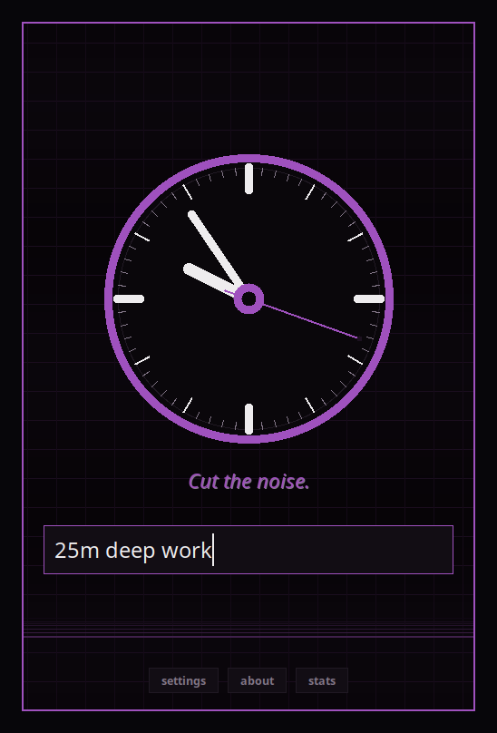
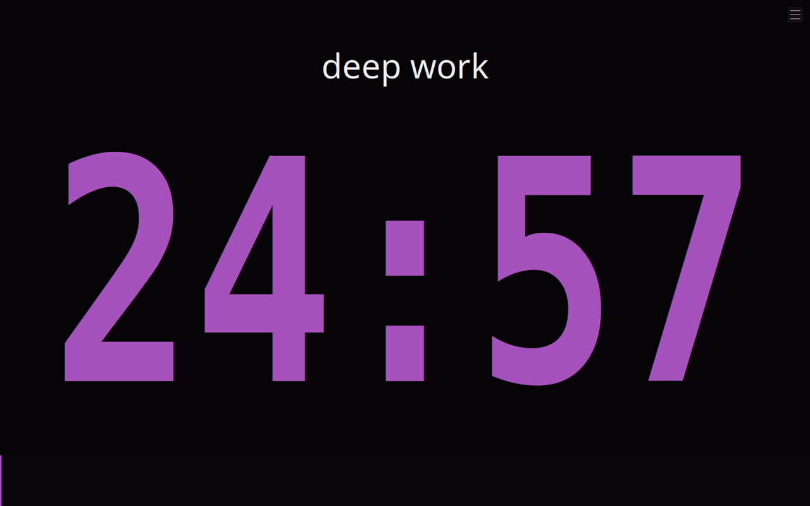
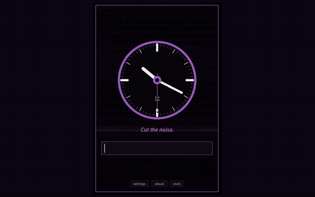
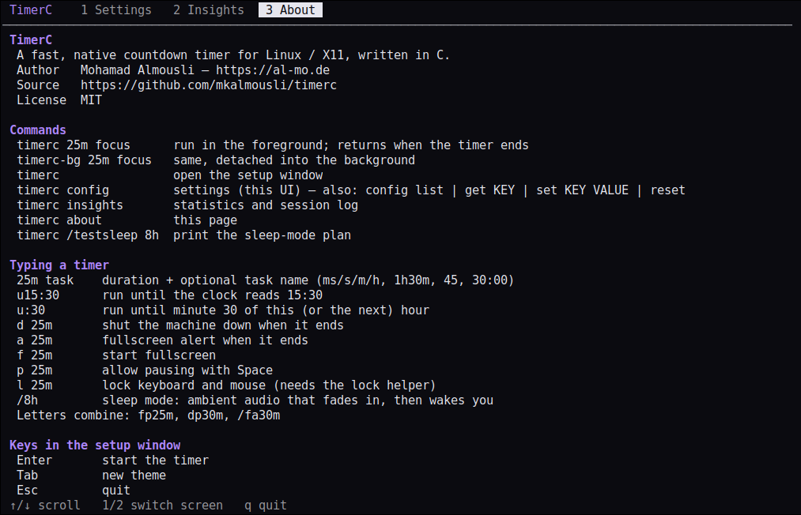
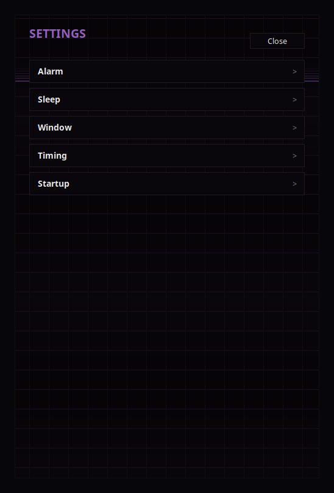
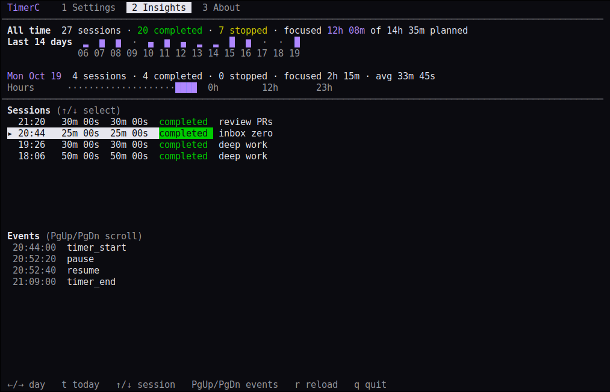
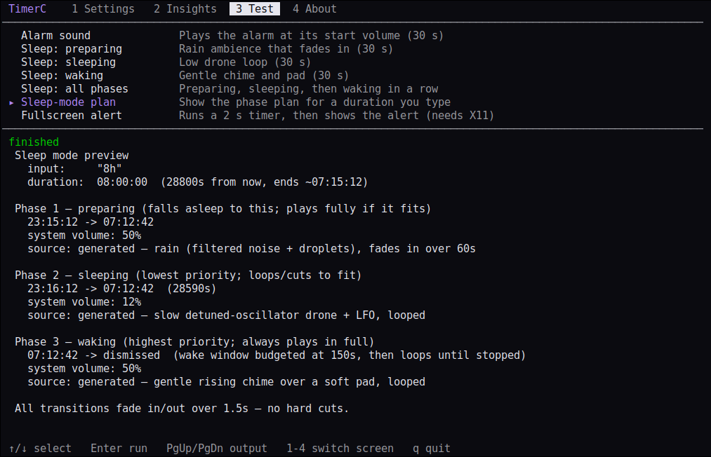

<div align="center">


# TimerC

**A fast, native countdown timer for Linux / X11 — written in pure C.**
No GTK, no Qt, no Python, no Electron. Just Xlib, Xft and SQLite.

[](https://github.com/mkalmousli/timerc/actions/workflows/ci.yml)
[](https://github.com/mkalmousli/timerc/releases)
[](LICENSE)


[Website](https://al-mo.de/tools/timerc/) · [Releases](https://github.com/mkalmousli/timerc/releases) · [Author](https://al-mo.de)

&nbsp;&nbsp;

</div>

## Demo

<a href="https://al-mo.de/tools/timerc/#demo"></a>

▶ [Watch the full-quality video on the website](https://al-mo.de/tools/timerc/#demo)

## Install (one command)

```sh
curl -fsSL https://raw.githubusercontent.com/mkalmousli/timerc/main/install.sh | sh
```

Works on Debian/Ubuntu, Fedora/RHEL, Arch, openSUSE, Alpine and Void: it installs any missing
build dependencies with your package manager, builds TimerC and installs it to `~/.local`
(no root for TimerC itself). Prefer manual? `make && make install`.

**Standalone binaries** (no dependencies at all, x86_64 and aarch64) are on the
[releases page](https://github.com/mkalmousli/timerc/releases/latest):

```sh
curl -fLo timerc https://github.com/mkalmousli/timerc/releases/latest/download/timerc-linux-x86_64-static
chmod +x timerc && ./timerc 25m focus    # use ...-aarch64-static on ARM64; `ln -s timerc timerc-bg` for the background command
```

Also available: glibc and musl tarballs (x86_64, i686, aarch64, armv7) and `.deb` packages.

## Two commands

| Command | Behavior |
|---|---|
| `timerc 25m focus` | **Foreground** — blocks until the timer ends, so it composes in scripts: `timerc 5m && notify-send "tea!"` |
| `timerc-bg 25m focus` | **Background** — same program, detaches from the terminal and returns instantly |

Run either with no arguments for the interactive setup screen.

## Usage

```sh
timerc 25m deep work     # 25 minute timer, task "deep work"
timerc 1h30m             # also: 45, 30:00, 1:30:00
timerc u16:30 meeting    # count down to 16:30 (u:30 = minute 30 of the hour)
timerc p25m              # pausable (Space)
timerc f1h               # fullscreen
timerc a10s              # fullscreen alert when done
timerc d30m              # shut the machine down when done
timerc l25m focus        # lock keyboard and mouse (see below)
timerc /8h               # sleep mode (see below)
timerc --version
```

Switch letters can be combined in any order: `fp25m`, `dp30m`. Options: `-m alert|shutdown`,
`-p`, `-f`, `-l`, `--theme NAME`, `-V`, `-h`. Man page: `man timerc`.

## Features

- **Instant & tiny** — a ~190 KB native binary.
- **Setup screen** with live preview of what you typed; fullscreen and mini modes (right-click toggles).
- **12 dark themes** — Midnight, Dracula, Nord, Gruvbox, Rose, Forest, Ember, Crimson, Cyber, Amethyst, Solar and Mono. Switch on the input page with `Tab` / `Shift+Tab` or by clicking the dots; pick one with `--theme NAME`.
- **Procedural audio** — start/pause/half-time/last-seconds cues and a ramping alarm, synthesised in
  code (no audio files). Plays through `aplay`, `pacat`, `pw-play`, `ffplay` or `mpv`.
- **Sleep mode** — rain/drone ambience that fades in, sustains and wakes you gently; `/testsleep 8h` previews the plan.
- **Insights in the terminal** (`timerc insights`) — daily/weekly stats, hourly heatmap and a per-session event log, all local in SQLite.
- **Settings in the terminal** (`timerc config`) — a small TUI for every tunable, plus `config list|get|set|reset` for scripts.
- **Test things in the TUI** — audition the alarm and each sleep-mode phase, preview the sleep plan, try the fullscreen alert.
- **Man pages** — `man timerc`, `timerc-bg`, `timerc-config`, `timerc-insights`.
- **A minimal GUI** — the window only does three things: take your input, show the timer, ring the alarm.
- **Input lock** (`-l`) — optionally disconnects USB keyboard/mouse at kernel level for deep focus, with a watchdog that always gives them back.
- **Shutdown mode**, until-time timers, multi-monitor aware, `timerc about` for syntax and keys.

## Screenshots

| | | |
|---|---|---|
|  |  |  |
| Setup | Live parsing | `timerc about` |
|  |  |  |
| `timerc config` | `timerc insights` | Test screen (audio, sleep plan, alert) |

| Mini timer | Fullscreen | Alert |
|---|---|---|
|  |  |  |

## Keys

| Key | Action |
|---|---|
| `Enter` | Start | 
| `Tab` / `Shift+Tab` | Next / previous theme (or click a dot) |
| `Space` | Pause / resume (if pausable) |
| Right-click | Toggle mini ↔ fullscreen |
| Middle-click | Stop |
| `Esc` | Dismiss alert / quit |

## Build from source

```sh
# Debian/Ubuntu
sudo apt install build-essential pkg-config libx11-dev libxft-dev libxinerama-dev \
     libxrandr-dev libxrender-dev libfontconfig1-dev libsqlite3-dev
make            # builds timerc and timerc-lock-helper
make install    # PREFIX=~/.local by default; also installs timerc-bg, timerc-uninstall, man pages, desktop entry
```

Other distros: see [`install.sh`](install.sh) for the package names. 
### Uninstall

```sh
timerc-uninstall             # lists what it removes, asks to confirm
timerc-uninstall --purge     # also deletes settings, history and log (~/.config/timerc)
timerc-uninstall -n          # dry run;  -y skips the prompt
```

It works for any install prefix (`timerc uninstall` is the same command). Installed from the `.deb`? Use `sudo apt remove timerc`. From a source checkout, `make uninstall` also works.

### Input lock helper (optional)

`-l` disables the USB HID devices via sysfs, which needs root. TimerC itself never runs as root;
a tiny audited setuid helper does only that one job:

```sh
sudo make install-lock-helper
```

Without it `-l` falls back to a plain X11 grab. A watchdog re-enables the devices when time is up or if
TimerC dies. Only USB keyboards/mice are covered.

## Data

`~/.config/timerc/` (`$XDG_CONFIG_HOME`): `config.conf`, `data.db` (sessions), `timer.log`. Nothing leaves your machine.

## Project layout

```
src/core      app, config, parsing, database
src/ui        GUI screens (setup, timer, alert)
src/cli       terminal UI (config, insights, about)
src/audio     procedural synthesis
src/platform  Linux backend (audio, fs, lock)
```

## Contributing

Issues and PRs welcome — see [CONTRIBUTING.md](CONTRIBUTING.md).

## Author

Made by **[Mohamad Almousli](https://al-mo.de)** · [al-mo.de](https://al-mo.de) · MIT licensed.
